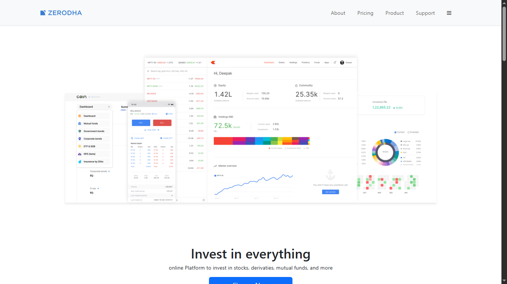
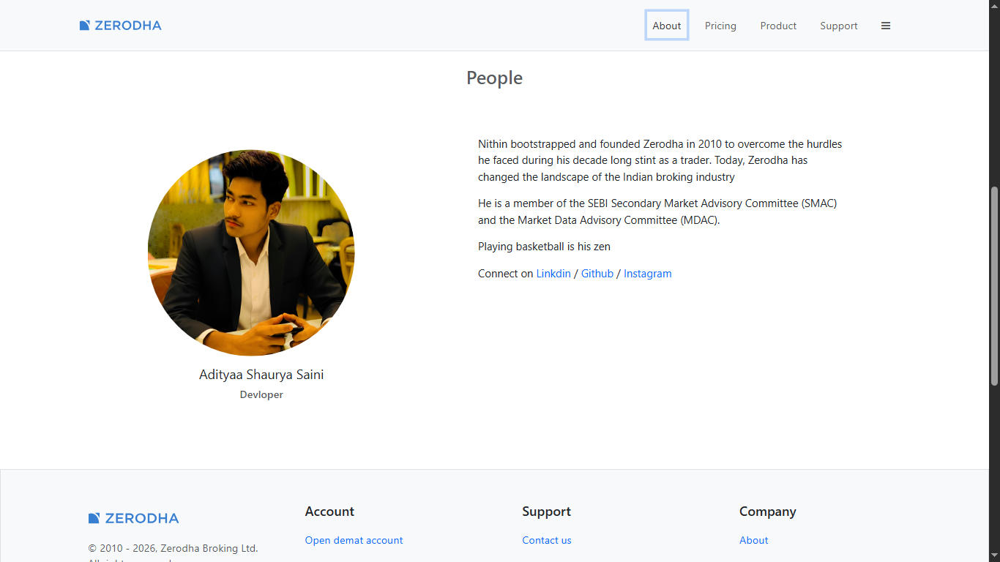

# Zerodha Frontend Clone

A frontend-only clone inspired by Zerodha, built using React and Vite. This project recreates the user interface of a stock trading platform with multiple pages, reusable components, and client-side routing. The focus of this project is frontend development, component reusability, routing, and responsive layouts for desktop and tablet devices.


## Screenshots

### Home Page




### About Page



## Features

* Multi-page React application
* Client-side routing with React Router
* Reusable and modular components
* Clean and organized project structure
* Responsive layout for desktop and tablet screens
* Landing page with product highlights
* Signup page interface
* About page
* Products page
* Pricing page
* Support page

## Tech Stack

* React
* Vite
* React Router
* JavaScript
* HTML5
* CSS3
* Bootstrap

## Project Structure

```text
zerodha-frontend/
├── public/
├── src/
│   ├── components/
│   ├── pages/
│   ├── assets/
│   └── ...
├── screenshots/
│   ├── homepage.png
│   ├── signup.png
│   ├── about.png
│   ├── products.png
│   ├── pricing.png
│   └── support.png
├── README.md
├── package.json
├── vite.config.js
└── index.html
```

## Installation

Clone the repository:

```bash
git clone <repository-url>
```

Move into the project directory:

```bash
cd zerodha-frontend
```

Install dependencies:

```bash
npm install
```

Start the development server:

```bash
npm run dev
```

Create a production build:

```bash
npm run build
```

Preview the production build:

```bash
npm run preview
```

## Pages

* Home
* Signup
* About
* Products
* Pricing
* Support

## Learning Outcomes

This project helped improve:

* React fundamentals
* Component-based architecture
* Routing and navigation
* Frontend project structure
* Responsive UI development
* Reusable component design
* Modern React workflow using Vite

## Notes

* Frontend-only project
* No backend integration
* Optimized for desktop and tablet devices
* Mobile responsiveness is not fully implemented

## Author

Aditya Saini
